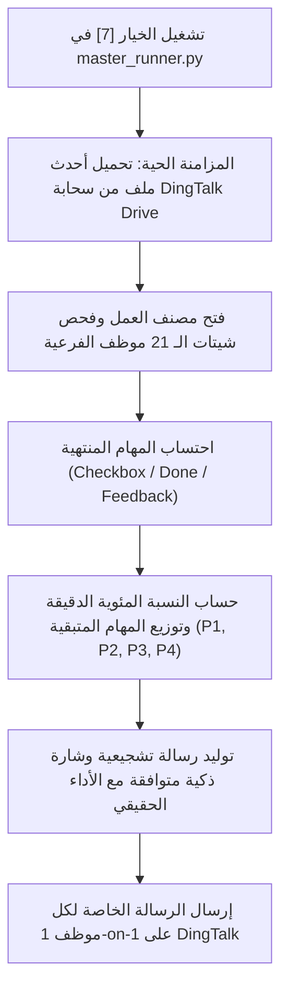

# 📘 دليل توثيق نظام مهام أكتوبر اليومية ومتابعة الموظفين الحية
## 51Talk Big Team 01 — October Daily Tasks & Live Rep Broadcaster Manual

---

### 📌 نظرة عامة (Overview)
يوثق هذا الدليل التحديثات والإصلاحات الجذرية التي تم تطبيقها على منظومة **October Daily Tasks** الخاصة بـ **Big Team 01 (إدارة Saber Hussien)**، وتشمل:
1. **تحديث شيت دنج توك الحي (DingTalk Sheets):** تطبيق نظام التلوين التمييزي لنسب الإنجاز وتنسيق صف الإجمالي في مكانه السحابي دون إنشاء ملفات مكررة أو روابط جديدة في الجروب.
2. **إصلاح محرك رسائل المتابعة الفردية للموظفين (`send_individual_rep_progress.py` / الخيار [7]):** ربطه بالمزامنة الحية المباشرة من سحابة دنج توك لتعكس الرسائل إنجازات الموظفين الحقيقية بدقة 100% بدلاً من الأصفار السابقة.

---

### 🎨 أولاً: تحديث وتنسيق الشيت السحابي الحي (DingTalk Sheets)

#### 1. المشكلة السابقة والسبب الجذري:
* عند فتح ملف `October Daily Tasks(4)` على دنج توك، كانت خانات `Completion Rate %` بيضاء بالكامل دون ألوان، وكان صف الإجمالي `ALL` غير مميز.
* **السبب الجذري:** السكريبت السابق قام بتطبيق التنسيق على الشيت الافتراضي النشط برمجياً (`All_Team_Master` - الشيت رقم 0) بدلاً من شيت لوحة المتابعة التنفيذية (`Completed_Archive` - الشيت رقم 22). بالإضافة إلى أن عارض دنج توك السحابي (Alidocs) يتطلب تطبيق التنسيق كـ **Direct Cell Styling** بجانب التنسيق الشرطي (**Conditional Formatting**) ليظهر فوراً على المتصفح والهاتف.

#### 2. التعديلات المطبقة:
* **تلوين عمود معدل الإنجاز (`Completion Rate %` - العمود H من الصف 6 إلى 110):**
  * **الأداء المميز ($\ge 80\%$):** خلفية خضراء هادئة (`#D1FAE5` Mint Green) + خط أخضر داكن عريض (`#065F46`).
  * **الأداء المتوسط ($50\% - 79.9\%$):** خلفية صفراء عنبرية هادئة (`#FEF3C7` Soft Amber) + خط عنبري عريض (`#92400E`).
  * **الأداء الضعيف ($< 50\%$):** خلفية حمراء فاتحة هادئة (`#FEE2E2` Soft Pastel Red) + خط أحمر قرمزي عريض (`#991B1B`).
  * توسيط الأرقام رأسياً وأفقياً وتنسيقها بالنسبة المئوية (`0.0%`).
* **تنسيق صف الإجمالي العام (`ALL` - الصف 111):**
  * **المحاذاة:** توسيط جميع الخلايا (من A111 إلى I111) في منتصف الخلية أفقياً ورأسياً (`Center`).
  * **اللون:** خلفية كحلية ملكية مميزة ومخالفة لدرجات الجدول (`#1E3A8A` Deep Royal Navy).
  * **الخط:** خط أبيض ناصع (`#FFFFFF`) عريض وواضح (`11.5pt Bold`).
  * **ارتفاع الصف:** 28pt لإعطاء مظهر قيادي مريح للعين.
* **الرفع السحابي في نفس المكان (In-Place Cloud Update):**
  * تم استبدال الملف على نفس العقدة السحابية عبر أمر:
    ```bash
    dws drive upload --file "October Daily Tasks.xlsx" --node "NDoBb60VLQ7g5ROqInqQoXqLJlemrZQ3" -y
    ```
  * لم يتم إرسال ملف جديد أو روابط جديدة في جروب الميجا، وتم الحفاظ على الرابط الأصلي:
    👉 [October Daily Tasks(4) Live Sheet](https://alidocs.dingtalk.com/i/nodes/NDoBb60VLQ7g5ROqInqQoXqLJlemrZQ3)

---

### 🚀 ثانياً: إصلاح محرك رسائل المتابعة الفردية (1-on-1 Rep Broadcaster)

#### 1. المشكلة السابقة:
عند تشغيل **الخيار رقم [7]** من `master_runner.py` واختيار إرسال التحديثات للموظفين، كانت الرسائل تصل لجميع الموظفين بأن المنجز لديهم هو **صفر** (Assigned = Pending)، رغم أن بعضهم أنجز 100% والبعض الآخر قطع شوطاً كبيراً في الشيت.

#### 2. السبب الجذري:
1. كان السكريبت يعتمد على ملف JSON محلي قديم (`unified_master_records.json`) أُنشئ صباحاً قبل بدء العمل، وكانت كل الحالات فيه مسجلة افتراضياً بـ `Pending`.
2. لم يكن السكريبت يقرأ شيتات الموظفين الحية على دنج توك إطلاقاً.
3. كان رابط الشيت المرفق بالرسائل يشير إلى شيت قديم من تاريخ 13 أكتوبر.

#### 3. الحل الجذري والتطوير البرمجي المطبق:
تمت إعادة بناء سكريبت `send_individual_rep_progress.py` ليعمل بالمنهجية الآتية:



#### 4. منطق احتساب إنجاز الموظف:
في شيت كل موظف (`Team XX - rep`):
* يتم فحص السجلات من الصف 6 فصاعداً:
  * **العمود J (Status Checkbox):** إذا كانت الخانة معلمة (`True`) أو تحتوي على كلمات (`Done`, `No Answer`, `Paid`, `Follow-up`, `Completed`).
  * **العمود K (Rep Feedback):** إذا قام الموظف بتدوين أي ملاحظة أو ملخص للمكالمة.
  * يُعتبر العميل **منتهياً (`Completed`)** وتُخصم من المعلق (`Pending`).

#### 5. الشارات الذكية والرسائل الإدارية:
* **نسبة إنجاز 100%:**
  * **الشارة:** `🌟 إنجاز استثنائي مكتمل (100%)`
  * **التشجيع:** *عاش يا بطل! أتممت جميع مهامك بنجاح تام اليوم. استمر في دعم الفريق وتحقيق المزيد! 🚀*
  * **المهام المعلقة:** `✅ تم الانتهاء من جميع المهام المعلقة بالكامل!`
* **نسبة إنجاز $\ge 80\%$:**
  * **الشارة:** `🚀 أداء متميز وعلى وشك الإنهاء (On Track)`
  * **التشجيع:** *أداء رائع ومبهر جداً! خطوة بسيطة وتقفل الـ 100% اليوم. عاش يا وحش! 👏*
* **نسبة إنجاز $\ge 50\%$:**
  * **الشارة:** `⚡ وتيرة ممتازة (Strong Pace)`
  * **التشجيع:** *أداء متقدم وقوي! ركز على باقي المهام المعلقة لتقفيل الهدف بالكامل اليوم! 💪*
* **نسبة إنجاز $> 0\%$:**
  * **الشارة:** `🔄 جاري العمل والمتابعة (In Progress)`
  * **التشجيع:** *بداية موفقة! ركز الآن على المهام العاجلة (P1 و P2) لرفع نسبة الإنجاز والوصول للهدف! 🎯*
* **نسبة إنجاز 0%:**
  * **الشارة:** `⏳ بانتظار بدء المتابعة (Action Needed)`
  * **التشجيع:** *يوم جديد وبداية قوية! افتح الشيت وابدأ فوراً بمهام Round 1 والمهام التي تنتهي اليوم! 🌟*

---

### 📋 ثالثاً: نموذج للرسالة الحقيقية بعد التحديث

```text
👋 مرحباً Julia Talaat Monir (Team 01)
📋 تحديث إنجاز مهام العمل اليومية | 2026-10-19 07:40 PM
━━━━━━━━━━━━━━━━━━━━━━━━━━━━━━
🎯 وضعك الحالي: 🌟 إنجاز استثنائي مكتمل (100%)

📊 مؤشرات إنجازك اليوم:
• إجمالي العملاء المكلف بهم: 11 عميل
• المهام المنتهية: 11 عميل (100.0%)
• المهام المعلقة المتبقية: 0 عميل

🔍 تفاصيل المهام المعلقة حسب الأولوية:
  • ✅ تم الانتهاء من جميع المهام المعلقة بالكامل!

💡 رسالة الإدارة:
عاش يا بطل! أتممت جميع مهامك بنجاح تام اليوم. استمر في دعم الفريق وتحقيق المزيد! 🚀

🔗 رابط الشيت أونلاين على DingTalk للمتابعة وتحديث حالتك:
👉 https://alidocs.dingtalk.com/i/nodes/NDoBb60VLQ7g5ROqInqQoXqLJlemrZQ3
━━━━━━━━━━━━━━━━━━━━━━━━━━━━━━
(تحديث فوري خاص بك من إدارة Big Team 01 - Saber Hussien)
```

---

### 📂 رابعاً: مسارات الملفات والسكربتات المعدلة

| الملف | المسار | الوظيفة |
| :--- | :--- | :--- |
| **محرك رسائل المتابعة** | `C:\Users\husse\Desktop\AI\03_workflows\send_individual_rep_progress.py` | يقرأ الشيت الحي سحابياً ويرسل الرسائل الفردية |
| **نسخة المجلد الاحتياطي** | `D:\Lens\Dashboard\scratch\send_individual_rep_progress.py` | نسخة احتياطية متزامنة من السكريبت |
| **القائمة الرئيسية** | `C:\Users\husse\Desktop\AI\03_workflows\master_runner.py` | الخيار رقم `[7]` لتشغيل الإرسال الفردي |
| **رابط الشيت المحدث** | `D:\Lens\Dashboard\latest_online_sheet_url.txt` | يحتوي على الرابط الحي النشط دائماً |

---

### ⚙️ خامساً: طريقة الاستخدام اليومي السريع

1. افتح موجه الأوامر أو الملف التنفيذي `RUN_MASTER.bat` وافتح `master_runner.py`.
2. اختر الرقم **`[7]`** (1-on-1 Individual Representative Progress Broadcaster).
3. اختر:
   * **`[1]`** للإرسال لجميع الـ 21 موظف دفعة واحدة بأرقامهم الحية.
   * أو **`[2]`** لاختيار فريق محدد (مثل `Team 01`).
   * أو **`[3]`** لاختيار موظف بعينه (مثل `juliamonir01`).
   * أو **`[4]`** لمعاينة الرسائل فقط دون إرسالها (`Dry-Run`).
