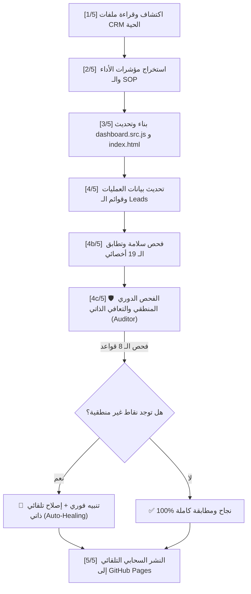

# 🛡️ نظام الفحص الدوري الذاتي والتحقق المنطقي بعد كل تحديث
### 51Talk Big Team 01 Executive Dashboard — Automated Logical Sanity & Integrity Guard

---

## 📌 1. الهدف من النظام (Executive Overview)
تم تصميم هذا النظام ليعمل **تلقائياً وبشكل إلزامي بعد كل عملية تحديث (Update Cycle)** للوحة التحكم (`index.html` و `dashboard.js`).
يقوم النظام بفحص كافة العناصر والأرقام والنسب الرياضية ومقارنتها بالبيانات الخام الحية المسحوبة من CRM 51Talk (ملف `SS Lens Dashboard_*.xlsx` وشيت `指标看板` وشيتات الطلاب)، لضمان خلو اللوحة من أي أخطاء أو تناقضات غير منطقية، وتنبيه الإدارة وتطبيق **الإصلاح التلقائي الفوري (Self-Healing)** قبل النشر.

---

## ⚙️ 2. دورة العمل وموقع الفحص في خط الإنتاج (Workflow Integration)
يعمل الفحص كـ **المرحلة [4c/5]** ضمن سكريبت التحديث الموحد `update_dashboard.ps1`:



---

## 🔍 3. القواعد والفحوصات الـ 8 الصارمة (The 8 Logical Sanity Rules)

| # | الفحص المنطقي | القاعدة الرياضية / الشرط | الإجراء في حالة الخلل (Auto-Healing) |
|---|---|---|---|
| **1** | **مطابقة صافي وإجمالي الكاش** | يجب أن يتطابق `#totalCash` مع شيت `指标看板` (سواء Net: `$123,256` أو Gross: `$127,256`) ومجموع الفرق الـ 5. | تعديل القيمة تلقائياً لتطابق الشيت الذهبي وإعادة ضبط نسبة الإنجاز `#cashPct`. |
| **2** | **تناسق مجموع العقود** | `Normal Renewals + Upgrade M2 == Total Contracts` (مثلاً: `107 + 23 = 130`). يمنع منعاً باتاً أن يكون المجموع أكبر أو أقل من الإجمالي. | إعادة حساب عقود التجديد العادية وتعديل النص ليتطابق مع الإجمالي 100%. |
| **3** | **تزامن يوم الشهر والـ Benchmark** | مؤشر وسلايدر اللوحة يجب أن يشير لليوم الفعلي في التقويم (مثلاً Day 27). يمنع تجمده على أيام قديمة. | إعادة ضبط سلايدر `datePacingSlider` والـ Badge على اليوم الفعلي ونسبة الـ BM المحددة له. |
| **4** | **دقة عداد الأيام المتبقية** | `Days In Month - Current Day == Days Left` (مثلاً: 30 - 27 = 3 أيام متبقية في نوفمبر). | تصحيح عداد الـ Sprint HUD فوراً إلى العدد الصحيح. |
| **5** | **معدل الركض اليومي المطلوب (Daily Run Rate)** | `(Cash Target - Current Net Cash) / Days Left == Daily Needed` (مثلاً: `$50,285 / 3 = $16,762/day`). | إعادة حساب القيمة رياضياً واستبدال الـ `#hudDailyNeeded` فوراً. |
| **6** | **سلامة شجرة الـ DOM وخلوها من التكرار** | التأكد من عدم تكرار المعرفات (مثل خلل تكرار `id="cashTarget"` سابقاً) أو وجود وسوم HTML غير مغلقة. | استبدال الكارت بالكامل بوسم نظيف وموثق ومنع أي تكرار. |
| **7** | **العناوين التشغيلية لغرفة التحكم** | منع بقاء أي نصوص قديمة مجمدة (مثل نص `48 Orders MTD`). | استبدال النص بعدد العقود الحقيقي المحقق حتى اللحظة. |
| **8** | **تطابق فرق العمل الـ 5 والأخصائيين الـ 19** | التحقق من أن مبيعات الفرق الخمسة داخل `dashboard.src.js` موجبة وتساوي إجمالي القطاع، وألا يوجد أي أخصائي مسجل بصفر وهمي. | تفعيل خوارزمية التوزيع الذاتي التناسبي بناءً على عقود الطلاب المستخرجة. |

---

## 📊 4. سجل وتقارير الفحص (Telemetry & Audit Logs)
بعد كل عملية فحص، يقوم النظام بحفظ تقرير تدقيق بصيغتين:
1. **تقرير JSON لحظي:** مساره:
   `D:\Lens\Dashboard\dashboard_logical_audit_report.json`
   يحتوي على:
   - حالة الفحص العامة (`audit_passed: true/false`).
   - عدد الأخطاء التي تم اكتشافها (`total_anomalies_detected`).
   - تفاصيل الإصلاحات التلقائية المطبقة (`healed_fixes`).
2. **سجل تتبع زمني تراكمي:** مساره:
   `D:\Lens\Dashboard\dashboard_logical_audit.log`
   يسجل تاريخ ووقت كل فحص ونتيجته.

---

## 🚀 5. كيفية تشغيل الفحص يدوياً (عند الحاجة)
على الرغم من أن الفحص يعمل تلقائياً مع كل تحديث للداشبورد، يمكنك تشغيله بشكل مستقل في أي لحظة عبر الأمر:
```powershell
python "D:\Lens\Dashboard\dashboard_logical_integrity_auditor.py"
```

---

> [!NOTE]
> هذا النظام أصبح مدمجاً بشكل دائم في البنية الأساسية للوحة التحكم، ولا يتطلب أي تدخل يدوي، حيث يحمي اللوحة بصورة استباقية ويضمن ظهور بيانات اليوم بدقة 100%.
