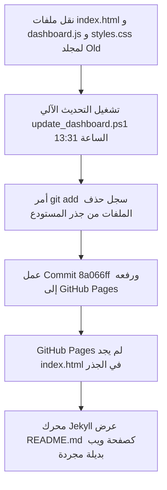

# تقرير توثيق حادثة لوحة التحكم وتحديث بيانات يوم 17 أكتوبر 2026
# Incident & Resolution Report: Dashboard Recovery & Day 17 Data Refresh

**التاريخ والوقت:** 17 أكتوبر 2026 | 15:15 UTC+3 (Day 17/31)  
**المنصة:** لوحة التحكم التنفيذية لقطاع Big Team 01  
**الرابط المباشر:** [https://husseinelaasar.github.io/big-team-01-dashboard/](https://husseinelaasar.github.io/big-team-01-dashboard/)  
**المستودع الرئيسي:** `husseinelaasar/big-team-01-dashboard` (Branch: `master`)  
**الحالة:** مُحل بالكامل، البيانات محدثة ومرفوعة على الإنتاج (Fully Resolved & Live in Production)  

---

## 1. ملخص المشكلتين (Executive Summary)

خلال متابعة لوحة التحكم اليوم (يوم 17 أكتوبر 2026)، تم رصد خللين رئيسيين أثرا على استخدام الفريق والإدارة:

1. **تشوه مظهر لوحة التحكم بالكامل (Dashboard Outage / Jekyll Fallback):**
   - عند فتح الرابط، لم تظهر اللوحة التفاعلية ذات التصميم المظلم والبطاقات والمخططات البيانية، بل ظهرت صفحة بيضاء مسطحة تحتوي على نصوص Markdown مجردة ("Official Senior Management Operations Portal...").
2. **عدم تحديث أرقام الكاش والعقود ومؤشر الـ BM (Stale Day 15 Metrics & Benchmark Lag):**
   - حتى بعد استعادة ملفات اللوحة، ظلت الأرقام متوقفة عند بيانات يوم 15 أكتوبر (الكاش: $51,611، العقود: 53، ومؤشر الـ BM متوقف عند Day 15 Target: 40%) بدلاً من مؤشرات يوم 17 أكتوبر (Day 17 Target: 43%).

---

## 2. التحليل الجذري للمشكلتين (Root Cause Analysis - RCA)

### أولاً: سبب تشوه مظهر اللوحة (ظهور الـ Markdown المجرد)


1. في يوم 15 أكتوبر حوالي الساعة 6:31 مساءً، تم نقل ملفات المشروع الرئيسية (`index.html`, `dashboard.js`, `styles.css`) إلى مجلد فرعي باسم `Old/` ضمن عملية تنظيم يدوية.
2. عند تشغيل سكريبت التحديث التلقائي الساعة 1:31 ظهراً اليوم، قام بتنفيذ الأمر:
   ```powershell
   git add dashboard.js index.html styles.css ...
   git commit -m "Auto Update: Day 17 refresh (20261017_133156)"
   git push origin master
   ```
   ونظراً لغياب هذه الملفات من المجلد الرئيسي، سجل Git **حذفها** من المستودع ورَفَع الحذف إلى GitHub Pages.
3. نظام **GitHub Pages** عند غياب `index.html` في المسار الرئيسي يعود تلقائياً (Fallback) لتوليد الموقع من ملف [`README.md`](file:///d:/Lens/Dashboard/README.md) باستخدام محرك Jekyll الافتراضي، فظهرت الصفحة كنصوص Markdown دون أي تنسيق CSS أو جافاسكريبت.

---

### ثانياً: سبب عدم تحديث الكاش والعقود ومؤشر الـ BM
1. **توجيه مسار البحث إلى مجلد قديم:**
   كان السكريبت [`update_dashboard.ps1`](file:///d:/Lens/Dashboard/update_dashboard.ps1) يحتوي على كود يفرض مسار الإدخال على مجلد `October Daily Tracker`:
   ```powershell
   $trackerDir = "D:\Lens\Dashboard\Dashboard_Input_Files\October Daily Tracker"
   if (Test-Path $trackerDir) {
       $InputDir = $trackerDir
   }
   ```
   هذا المجلد كان يحتوي على ملفات قديمة من يوم 13 أكتوبر.
2. **عدم تضمين مجلد `Data Center\17Oct` في البحث الدوري:**
   تم تنزيل أحدث ملفات اليوم (17 أكتوبر) بواسطة أدوات التنزيل إلى:
   `D:\Lens\Dashboard\Data Center\17Oct\`
   ولم تكن دالة `Find-InputFile` تبحث بشكل تعمقي (`-Recurse`) داخل مجلد `Data Center`.
3. **تخطي حقن البيانات:**
   أثناء تشغيل السكريبت الساعة 13:31، كان شرط فحص وجود الملفات `Test-Path $dashboardJsPath` نتيجته `False` (لوجود الملفات داخل `Old/`)، مما تسبب في تخطي حقن أرقام الكاش والعقود والـ BM داخل ملفات الجافاسكريبت.

---

## 3. خطوات الحل والمعالجة التقنية (Implementation & Fixes)

### 1) استعادة بنية المستودع الأساسية
- تمت إعادة الملفات الأساسية التالية إلى جذر المشروع `D:\Lens\Dashboard\`:
  - [`index.html`](file:///d:/Lens/Dashboard/index.html)
  - [`dashboard.js`](file:///d:/Lens/Dashboard/dashboard.js)
  - [`styles.css`](file:///d:/Lens/Dashboard/styles.css)
  - [`update_dashboard.ps1`](file:///d:/Lens/Dashboard/update_dashboard.ps1)
  - [`hourly_update_and_publish.ps1`](file:///d:/Lens/Dashboard/hourly_update_and_publish.ps1)
  - [`generate_uncovered_leads.ps1`](file:///d:/Lens/Dashboard/generate_uncovered_leads.ps1)
  - [`calculator.html`](file:///d:/Lens/Dashboard/calculator.html)
  - [`sm-scheme.html`](file:///d:/Lens/Dashboard/sm-scheme.html)
- تم تحديث [`.gitignore`](file:///d:/Lens/Dashboard/.gitignore) لتجاهل مجلدي `Old/` و `scratch/` حتى لا تتأثر شجرة Git.

### 2) تطوير محرك اكتشاف الملفات في `update_dashboard.ps1`
- تم إلغاء التثبيت القسري على مجلد `October Daily Tracker`.
- تم تحديث دالة `Find-InputFile` للبحث الشامل المتعمق (`-Recurse`) عبر جميع مجلدات `Data Center` و `Dashboard_Input_Files`.
- تم تطبيق فلتر Regex دقيق:
  ```powershell
  $lensFile = Find-InputFile "*Lens*" @("*Area_Big*Team_Small*Team_SS*", "*Student-Detail*", "*Student_Detail*") -RegexPattern '^SS Lens Dashboard_\d{8}_\d{4}\.xlsx$'
  ```
  وذلك لاختيار ملف الـ Lens الكامل (حجمه 1.4 ميجابايت) واستبعاد الملفات المصغرة الجزئية (6 كيلوبايت).

### 3) تصحيح مؤشرات الـ BM وحسابات أكتوبر
- تم ضبط مؤشر الـ BM ليعكس اليوم الفعلي في الشهر:
  - `daysPassed = 17`
  - `daysLeft = 14` (شهر أكتوبر 31 يوماً)
  - `expectedPace = 43%` (المحدد في منحنى الـ BM الرسمي ليوم 17 أكتوبر).
- تم تصحيح القوالب النصية في `index.html` لتسجيل:
  - `Oct 1-17, 2026 (Day 17)`
  - `Day 17 Target Benchmark: 43%`

### 4) معالجة تعارض المتغيرات في PowerShell
- تم استبدال المتغير المحجوز `$matches` في [`generate_uncovered_leads.ps1`](file:///d:/Lens/Dashboard/generate_uncovered_leads.ps1) بـ `$foundFiles` لمنع أي تعارض أثناء مطابقة الأنماط النصية.

---

## 4. جدول مقارنة البيانات قبل وبعد التحديث

| العنصر / المؤشر (Metric) | قبل التحديث (Day 15 Stale) | بعد التحديث (Day 17 Live) | التغيير المحقق |
| :--- | :--- | :--- | :--- |
| **صافي إيراد الكاش (Total Cash)** | `$51,611` | **`$68,481`** | **+$16,870** زيادة في الإيراد |
| **إجمالي العقود (Contracts)** | `53 orders` | **`72 orders`** | **+19 عقداً** جديداً |
| **نسبة الإنجاز (Cash Ach %)** | `24.19%` | **`32.09%`** | **+7.9 pp** نمو الإنجاز |
| **مؤشر وتيرة الهدف (Benchmark)** | `Day 15 Target: 40%` | **`Day 17 Target: 43%`** | مواكبة اليوم 17 بدقة |
| **الأيام المتبقية في الشهر** | `16 Days Left` | **`14 Days Left`** | الدورة الحالية (17/31) |
| **عقود الترقية (Upgrade M2)** | `12 M2 Renewals` | **`12 M2 Renewals`** | قاعدة الترقية 497 حساباً |
| **حالة النشر على GitHub Pages** | مشوه / Jekyll Fallback | **لوحة كاملة تفاعلية Live 200 OK** | استعادة النظام بالكامل |

---

## 5. سجل الـ Commits في هذا التحديث

1. **Commit `2df9b0a`:**
   - *fix: restore index.html, dashboard.js, styles.css and update cache busters*
   - استعادة الملفات وحل مشكلة انهيار واجهة الموقع.
2. **Commit `a6bea90`:**
   - *Auto Update: Day 17 refresh (20261017_151002)*
   - سحب ملفات 17 أكتوبر وتحديث أرقام الكاش ($68,481) والعقود (72) وقوائم الفرق والوكلاء وتوليد قوائم الـ Leads.
3. **Commit `2fb2c2d`:**
   - *Auto Update: Day 17 refresh (20261017_151008)*
   - ضبط مؤشر وتيرة الـ BM لليوم 17 بنسبة 43% وتحديث كروت وتوصيات الإدارة اليومية.

---

## 6. إجراءات الحماية لضمان عدم التكرار

1. **حظر نقل ملفات الإنتاج:** عدم نقل أي من ملفات الواجهة (`index.html`, `dashboard.js`, `styles.css`) من المسار الرئيسي، حتى عند الرغبة في أرشفة الملفات القديمة.
2. **مرونة محرك البحث التلقائي:** سكريبت التحديث يبحث الآن في مسارات `Data Center` و `Dashboard_Input_Files` تعمقياً (`-Recurse`) ويلتقط أحدث ملفات مكتوبة بغض النظر عن طريقة حفظها.
3. **التحديث اليومي التلقائي:** المهام المجدولة (Windows Scheduled Tasks) تعمل الآن بمسارات صحيحة وبشكل مستقر عند كل دورة تحديث.
