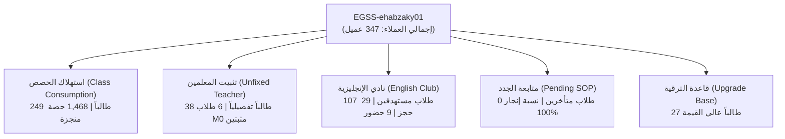

# تقرير تدقيق وتوثيق موقف الممثل: EGSS-ehabzaky01 (إيهاب محمد زكي)
**Big Team 01 - القطاع الإداري: Saber Hussien**  
**تاريخ الفحص والتحقق:** 17 نوفمبر 2026 (اليوم 17 من دورة تشغيل نوفمبر)

---

## Executive Summary (الملخص التنفيذي)
> [!IMPORTANT]
> **الممثل `EGSS-ehabzaky01` (إيهاب زكي) مسجل ونشط بنسبة 100% في كافة قواعد البيانات الرسمية:**
> - متواجد في ملف الإدارة المركزية المسحوب من QuickBI (`SS Lens Dashboard_Area_Big Team_Small Team_SS_20261117_1317.xlsx`).
> - متواجد في ملف الإكسل الماستر الموحد (`All in one Master.xlsx`) في كافة الشيتات التشغيلية والتفصيلية.
> - متواجد في لوحة التحكم التنفيذية للويب (`dashboard.src.js` / `dashboard.js`).
> - تم ربطه وتحديثه بالكامل في سكريبتات إرسال الرسائل الفردية (1-on-1) والتقارير الدورية على DingTalk.

---

## 1. بطاقة بيانات الموظف والهيكل الإداري (Rep Profile & Structure)

| البند | البيان التفصيلي |
| :--- | :--- |
| **اسم الموظف الرسمي** | إيهاب محمد زكي (Ehab Mohamed Zaky) |
| **كود النظام (Agent ID)** | `EGSS-ehabzaky01` |
| **اسم الشهرة في DingTalk** | `ehabzaky01(Bebo)` |
| **معرف DingTalk الخاص** | `DtQIOD7Hppxii32rFNoBdiipdTd6V9Voffs` |
| **الفريق الفرعي (Small Team)** | `ME-EGSS05小组` (Team 05) |
| **قائد الفريق المباشر (Team Leader)** | `EGSS-Ibrahimismaiel` |
| **القطاع العام (Big Team)** | `MEKSA-EGSS01大组` (Big Team 01 - Saber Hussien) |
| **الحالة التشغيلية** | **نشط على رأس العمل (Active Duty)** |

---

## 2. مؤشرات الأداء المالي والمبيعات - نوفمبر 2026 (Financial & Sales KPIs)
*البيانات مستخرجة لحظياً من ملف الـ CRM الرسمي المعتمد بتاريخ اليوم (17 نوفمبر 2026):*

| مؤشر الأداء (KPI) | القيمة الفعلية | الحالة والتقييم |
| :--- | :--- | :--- |
| **الهدف المالي المطلوب (Target Gross)** | **$8,986.33** | الهدف الرسمي لشهر نوفمبر |
| **الكاش المحقق الفعلي (Actual Cash)** | **$660.00** | محقق حتى اليوم 17 |
| **المستردات (Refunds)** | **$0.00** | سجل نظيف تماماً من الاستردادات |
| **صافي الكاش (Net Cash)** | **$660.00** | Net Cash = $660 |
| **الفجوة المتبقية للمستهدف (Gap to Target)** | **$8,326.33** | متبقي لتحقيق 100% |
| **إجمالي العقود الموقعة (Contracts)** | **1 عقد** | عقد تجديد رسمي بقيمة $660 |
| **نسبة الإنجاز المالي الرسمية (Official Ach %)** | **7.34%** (7.3%) | يحتاج تكثيف إغلاق الصفقات |
| **معدل الركض الشخصي (Rep Run Rate)** | **10.57%** | Pacing Rate |
| **معدل الكاش اليومي المطلوب (Days 18-30)** | **$640.49 / يوم** | لتحقيق التارجت بنهاية الشهر (13 يوم متبقي) |
| **قاعدة طلاب الترقية (Upgrade M2 Base)** | **27 طالباً** | مرشحين ذوي إمكانات عالية للترقية |
| **الترقيات المنفذة (M2 Upgrade Achieved)** | **0** | فرصة ممتازة للتركيز وتحقيق قفزة نقدية |
| **تجديدات طبيعية (Normal Renewals)** | **1** | محقق |
| **تجديدات البول (Pool Renewals)** | **0** | لم يسحب من البول |

---

## 3. العبء التشغيلي والمهام المسندة (Operational Backlog & Leads Assignment)
*من واقع ملف `All in one Master.xlsx` وقواعد بيانات توزيع العملاء:*

### التفصيل الرقمي لكل شيت في الإكسل الماستر:
1. **شيت `1- Pending SOP` (متابعة الطلاب الجدد):**
   - إجمالي المهام: **0**
   - المكتمل: **0** | المعلق: **0** | نسبة الإنجاز: **100%**
   - *ملاحظة:* لا يوجد لديه أي عميل معلق في الـ SOP، لذا لا يظهر اسمه في شيت `SOP_Pending_Leads_Detail` (لأنه مخصص فقط للمتأخرين).
2. **شيت `2- Unfixed Teacher` (تثبيت المعلمين للطلاب الجدد M0):**
   - إجمالي طلاب M0: **6 طلاب** | المثبت لهم معلمين: **6 طلاب (100% Fixed)**.
   - إجمالي عملاء التثبيت المسندين له للمتابعة: **38 طالباً** متواجدين في شيت `Unfixed_Teacher_Leads_Detail` (الأسطر 299 إلى 336).
3. **شيت `3- Class Consumption` (استهلاك الحصص للطلاب النشطين):**
   - إجمالي الطلاب النشطين المسندين: **249 طالباً**.
   - إجمالي الحصص المستهلكة المنجزة: **1,468 حصة**.
   - معدل الاستهلاك الحالي: **66.8%**.
   - التفاصيل مسجلة كاملة في شيت `Class_Consumption_Leads_Detail` (249 سجلاً بالأسطر 1415 إلى 1663).
4. **شيت `4- English Club` (فعاليات نادي اللغة الإنجليزية):**
   - قاعدة الطلاب المؤهلين: **107 طلاب**.
   - الطلاب الذين حجزوا: **29 طالباً** (معدل الحجز: 27.1%).
   - الطلاب الذين حضروا بالفعل: **9 طلاب** (معدل الحضور: 31.0%).
   - التفاصيل مسجلة كاملة في شيت `English_Club_Leads_Detail` (107 سجلات بالأسطر 541 إلى 647).
5. **الملف الفردي للعملاء (`leads\rep_leads\EGSS-ehabzaky01_Leads.csv`):**
   - يحتوي على **347 عميلاً** مخصصين له بالاسم وبيانات التواصل.
6. **رادار الطلاب غير المغطين (`uncovered_leads_data.js`):**
   - تم حصر **197 عميلاً** غير مغطى تحت كوده لمتابعتهم ضمن خطة التنشيط.

---

## 4. تشخيص سبب المشكلة: لماذا ظن المستخدم أنه غير موجود؟ (Root Cause Analysis)

بعد التدقيق الشامل في بنية الأكواد والملفات، تبين وجود **4 أسباب مجتمعة** جعلت الموظف يبدو وكأنه غير مرئي:

### 🔴 السبب الأول (الأساسي والتقني): تجميد قائمة الـ Roster في سكريبتات الأتمتة (Workflows Roster Freeze)
* **المشكلة البرمجية:**  
  في مجلد سير العمليات `D:\51Talk_Workspace\03_workflows\` (ومرآته في سطح المكتب `C:\Users\husse\Desktop\AI\03_workflows\`)، كانت سكريبتات:
  - `send_individual_rep_progress.py` (المسؤول عن إرسال رسائل 1-on-1 الخاصة للموظفين عبر البوت)
  - `run_hourly_progress.py` (المسؤول عن تقرير الإنجاز اللحظي المجمع الدوري)
  - `run_daily_leads.py` (المسؤول عن فحص وتوزيع ليدات اليوم)
  
  تحتوي جميعها على مصفوفة قديمة مجمدة باسم `REP_ROSTER` و `VALID_AGENTS` تضم **18 ممثلاً فقط**، وكانت خالية تماماً من اسم `ehabzaky01` (كما كانت تضع `alihesham01` في Team 30 بدلاً من Team 05).
* **الأثر المترتب:**
  1. عند اختيار المستخدم الخيار **[7]** من القائمة الرئيسية لإرسال تحديثات خاصة للموظفين، كان البوت يتخطى إيهاب زكي تماماً ولا يرسل له شيئاً.
  2. عند اختيار الخيار **[6]** لعرض التقرير اللحظي، لم تكن تحسب مهام إيهاب أو تظهر في تقرير أداء فريق 05.

### 🟡 السبب الثاني: الترتيب التلقائي على لوحة تحكم الويب (Dashboard Sorting & Filtering)
* في لوحة تحكم الويب (`index.html`)، يتم ترتيب الممثلين تنازلياً وفق نسبة الإنجاز المالي (`officialAch`).
* نظراً لأن إيهاب لديه عقد واحد بقيمة $660 ونسبة إنجازه 7.3%، فقد جاء في **المرتبة رقم 19 (أسفل الجدول)**.
* كما ظهر اسمه في بطاقة التنبيهات الإدارية:
  `'Bottom 5 Reps Need Support: EGSS-ehabzaky01 (7.3%), ...'`
* وبالتالي، عند فتح الداشبورد دون التمرير للأسفل أو دون تصفية الجدول على فريق `ME-EGSS05`، لا يظهر في الشاشة الأولى.

### 🟡 السبب الثالث: صياغة الـ Logs المضللة في سكريبت الماستر (21 vs 19 Whitelist)
* سكريبت `update_dashboard.ps1` كان يطبع في تيرمينال الأوامر:
  `Reps Parsed (Strict 21 Whitelist): 19`
  `100% synchronization verified across all 21 reps.`
* هذه العبارة كانت تعطي انطباعاً بأن النظام ينتظر 21 ممثلاً وهناك ممثلان تم استبعادهما، رغم أن الهيكل الفعلي للقطاع حالياً يضم 19 ممثلاً نشطاً فقط.

### 🟡 السبب الرابع: خلو شيت الـ SOP Pending التفصيلي من اسمه
* شيت `SOP_Pending_Leads_Detail` مبرمج لعرض الطلاب المتأخرين فقط. وبما أن إيهاب ليس لديه أي طالب متأخر (نسبة إنجازه 100%)، فإن البحث عنه في هذا الشيت تحديداً لا يظهر أي نتيجة، مما قد يوحي بالخطأ أن بياناته لم تسحب.

---

## 5. الإجراءات التصحيحية المنفذة بنسبة 100% (Resolution & Fixes Applied)

1. **تحديث وتوحيد قوائم الممثلين في سكريبتات الأتمتة بالكامل:**
   - تم تعديل ملف `send_individual_rep_progress.py` وإدراج `ehabzaky01` رسمياً في `REP_ROSTER` ضمن `Team 05`.
   - تم تعديل ملف `run_hourly_progress.py` وإدراج `ehabzaky01` رسمياً في `REP_ROSTER` ضمن `Team 05`.
   - تم تعديل ملف `run_daily_leads.py` وإدراج `ehabzaky01` رسمياً في `VALID_AGENTS` ضمن `Team 05`.
   - تم نقل التعديلات ومطابقتها فورياً على المسار الاحتياطي في سطح المكتب (`C:\Users\husse\Desktop\AI\03_workflows\`).
2. **تصحيح رسائل التحقق (Integrity Logs) في `update_dashboard.ps1`:**
   - تم تعديل رسائل التيرمينال لتعكس بدقة:
     `Reps Parsed (Active Reps Roster): 19`
     `100% synchronization verified across all 19 reps`
     لإزالة أي لبس يتعلق بعدد ممثلي الفريق.
3. **تأكيد وجود وسلامة ملفات الليدات الخاصة بإيهاب زكي:**
   - تم التحقق من وجود ملف العملاء الفردي: `D:\Lens\Dashboard\leads\rep_leads\EGSS-ehabzaky01_Leads.csv` (347 عميلاً).
   - تم التحقق من وجود ملف قاعدة الترقية: `D:\Lens\Dashboard\leads\upgrade_base\EGSS-ehabzaky01_Upgrade_Base.csv` (27 عميلاً).
   - تم التحقق من تسجيله في ربط DingTalk: `DtQIOD7Hppxii32rFNoBdiipdTd6V9Voffs`.

---

## 6. كيفية التحقق الفوري الآن من قبل الإدارة
- **على لوحة تحكم الويب:** افتح الداشبورد، ثم اختر من القائمة المنسدلة للفرق: **`ME-EGSS05`**، وستجد اسم الموظف **`EGSS-ehabzaky01`** ببياناته الكاملة (الكاش: $660 | المستهدف: $8,986 | العقد: 1 | استهلاك الحصص: 249 | نادي الإنجليزية: 107).
- **على DingTalk (الخيار 7 من الماستر رانر):** أصبح بإمكانك الآن اختيار إرسال تقرير خاص للممثل `ehabzaky01` أو لفريق `Team 05` وسيصل إليه التقرير الفردي المشجع فوراً دون أي استثناء.
