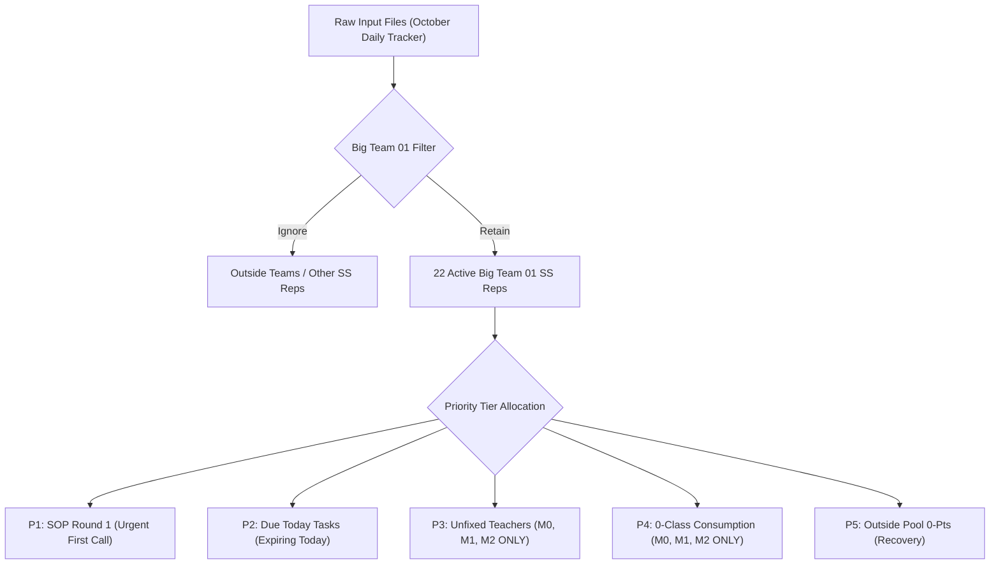
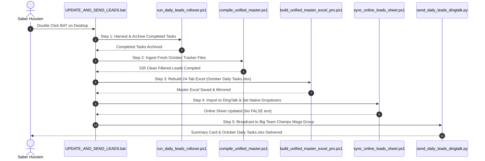

# 51Talk Big Team 01 - Master Daily Operations Leads System Manual
**Senior Manager:** Saber Hussien (`EGSS-Hussienmo`)  
**Scope:** Big Team 01 Exclusive (5 Small Teams | 22 SS Representatives)  
**Effective Date:** October 2026 (Live Cycle Active)  
**Official Workbook Name:** `October Daily Tasks.xlsx`

---

## 1. System Architecture & Master Locations

| Component | Path / Location | Purpose |
|:---|:---|:---|
| **Master Input Folder** | `D:\Lens\Dashboard\Dashboard_Input_Files\October Daily Tracker` | Official input folder where all daily QuickBI & Lens files are placed |
| **Master Output Workbook** | `D:\Lens\Dashboard\October Daily Tasks.xlsx` | 24-tab executive workbook (22 Reps + All Team + Completed Archive) |
| **Master Folder Mirror** | `D:\Lens\Dashboard\Dashboard_Input_Files\October Daily Tracker\October Daily Tasks.xlsx` | Permanent mirrored archive inside October Daily Tracker |
| **Desktop Workbook Mirror** | `C:\Users\husse\Desktop\October Daily Tasks.xlsx` | 1-Click access on Senior Manager desktop |
| **Desktop Daily Launcher** | `C:\Users\husse\Desktop\Run Master\UPDATE_AND_SEND_LEADS.bat` | 1-Click launcher running the full daily rollover & broadcast cycle |
| **Desktop Hourly Launcher** | `C:\Users\husse\Desktop\Run Master\CHECK_HOURLY_PROGRESS.bat` | Instant manual trigger for private hourly progress report |
| **Windows Scheduled Task** | `51Talk_Hourly_Progress` (Hourly / Repeat 1 Hour) | Background automated task pushing hourly updates to Saber Hussien |
| **Online DingTalk Sheet** | [👉 Open Alidocs Sheet](https://alidocs.dingtalk.com/i/nodes/dxXB52LJqnjXBmGdiZ7rdGZD8qjMp697) | Synchronized online spreadsheet with interactive status dropdowns |
| **DingTalk Team Group** | Group: `Big Team Champs - Mega` (`cidx9ITXJyqktd2CvhI8op0Ig==`) | Official broadcast group for all 22 SS reps + leaders + manager |
| **Private Executive Stream** | User: `EGSS-Hussienmo` (`DMmZ0gsytpviSWm51piSq3GstTd6V9Voffs`) | Private hourly progress updates sent exclusively to Saber Hussien |

---

## 2. Business Rules & Lead Tiers

### Strict Cohort Ingestion Rules
1. **Unfixed Teachers (P3):** Strictly restricted to cohorts **`M0`**, **`M1`**, and **`M2`**. All older `M3+` unfixed leads are explicitly excluded to keep reps laser-focused on active students.
2. **0-Class Consumption (P4):** Strictly restricted to cohorts **`M0`**, **`M1`**, and **`M2`**:
   * **`M0` Students:** New joiners enrolled in October with 0 classes consumed this month (`This month Class consumption = 0`). Total: **36 leads**.
   * **`M1` Students:** Total: **20 leads**.
   * **`M2` Students:** Total: **48 leads**.
   * **Combined Zero-Class Total:** Exactly **104 leads** across Big Team 01.
3. **Big Team 01 SS Rep Roster (22 Agents across 5 Small Teams):**
   * **Team 01 (6 reps):** `ashraqatal`, `hussienmo`, `juliamonir01`, `mahmoud04`, `negma`, `nohayoussry`
   * **Team 05 (6 reps):** `abdelrahmannasef`, `ehabzaky01`, `ibrahimismaiel`, `khaledgonam`, `omarmoneb`, `samira01`
   * **Team 10 (3 reps):** `abdelrhmanshehata`, `ahmedshoukry`, `mahmoudkhamis`
   * **Team 13 (4 reps):** `amrsafwat`, `hayamhassan`, `marwaahmed`, `mohamedha`
   * **Team 30 (3 reps):** `adhmgadallah`, `alihesham01`, `titooooo`

---

## 3. Interactive Column J Status (DingTalk & Excel)

* **No More `FALSE` text:** Column J defaults to **`Pending`** with an amber/orange tag (`#faad14`).
* **1-Click Completion:** Reps tap the cell on DingTalk web or mobile and select **`Done ✓`** (vibrant green `#52c41a`).
* **Automated Rollover:** The morning rollover engine (`run_daily_leads_rollover.ps1`) automatically scans for `Done ✓` / `Done` / `[x]`, archives them to `Completed_Archive`, and keeps pending tasks active.
* **Pure English & Screen Fitting:**
  * 100% Zero Chinese text across all headers, dropdown options, and action labels.
  * Columns A:M compressed to 157.5 width units at 75% zoom, ensuring complete on-screen visibility without horizontal scrolling.

---

## 4. Daily Automated Execution Cycle

---

## 5. Private Hourly Progress Monitor (`EGSS-Hussienmo`)

* **Engine Script:** `D:\Lens\Dashboard\send_hourly_progress_dingtalk.py`
* **Direct Desktop Trigger:** `C:\Users\husse\Desktop\Run Master\CHECK_HOURLY_PROGRESS.bat`
* **Windows Task Scheduler:** `51Talk_Hourly_Progress` (runs hourly in background)
* **Recipient:** Strictly 1-on-1 private chat to Saber Hussien (`DMmZ0gsytpviSWm51piSq3GstTd6V9Voffs`).
* **Delivered Content:**
  * Executive KPIs: Total target leads (`535`), archived & completed leads (`137`), pending (`398`), completion rate (`25.6%`).
  * Team-by-team breakdown: Teams 01, 05, 10, 13, 30.
  * Operational priority breakdown: P1 (19), P2 (155), P3 (165), P4 (104), P5 (151).
  * Direct clickable link to the live online sheet.

---

## 6. Technical Protocols & Bug Resolution History

### A. Title-Only Display Bug Resolution (Full Report Visibility)
* **Root Cause 1 (CMD Batch Newline Truncation):** Invoking `dws.cmd` directly caused Windows Command Prompt to treat newline characters (`\n`) as command terminators, dropping all lines after line 1.  
  * **Fix:** Direct execution via `node.exe` and `dws.js` (`C:\Program Files\nodejs\node.exe` + `dingtalk-workspace-cli/bin/dws.js`).
* **Root Cause 2 (AI Card Badge Truncation):** Default `--ai-tag=true` forced DingTalk to render messages as collapsed AI cards displaying only the title badge.  
  * **Fix:** Explicitly passing `--ai-tag=false` and `--text` to deliver fully expanded native text bubbles.
* **Root Cause 3 (Unicode Security Rejection `code 3`):** Compound emojis (e.g. `👨‍🏫`) contained hidden Zero-Width Joiner (`U+200D`) characters that triggered DingTalk's security validator (`content contains dangerous Unicode characters`).  
  * **Fix:** Sanitizing all zero-width characters (`\u200d`, `\u200c`, `\u200b`, `\ufeff`) prior to transmission.

### B. Official Workbook Naming Standard
* **Approved Name:** **`October Daily Tasks.xlsx`**
* **Active Locations:**
  1. `D:\Lens\Dashboard\October Daily Tasks.xlsx`
  2. `D:\Lens\Dashboard\Dashboard_Input_Files\October Daily Tracker\October Daily Tasks.xlsx`
  3. `C:\Users\husse\Desktop\October Daily Tasks.xlsx`
* **Broadcast Target:** `Big Team Champs - Mega` (`cidx9ITXJyqktd2CvhI8op0Ig==`).

### D. Drive In-Place File Formula Synchronization (`October Daily Tasks.xlsx`)
* **Incident Analysis:**
  * When employees (such as `juliamonir01`) marked tasks as `"Done"` and added notes in their individual subsheets, the summary monitor `Completed_Archive` continued showing `0` Completed and `0` Pending.
  * **Root Cause 1 (Data Type Mismatch):** The workbook formulas in `Completed_Archive` checked for boolean `TRUE` (`COUNTIFS(..., TRUE)`), whereas reps entered or selected the text value `"Done"`. In Excel, `COUNTIFS(..., TRUE)` ignores string values.
  * **Root Cause 2 (Pending Calculation):** Pending tasks checked for boolean `FALSE` (`COUNTIFS(..., FALSE)`), returning `0` instead of calculating `=E - F` (`Total Assigned - Completed Tasks`).
  * **Root Cause 3 (Drive File vs. Alidocs Node):** The file shared with the team was a DingTalk Drive `.xlsx` file (`7dx2rn0JbYKPbR97sNa40jbqVMGjLRb3`). Previous formula patches had targeted the online sheet node rather than the active shared Drive file.
* **Resolution Without Resending Any New File:**
  1. Downloaded the active live file from DingTalk Drive (`node: 7dx2rn0JbYKPbR97sNa40jbqVMGjLRb3`) preserving all employee updates (such as Julia's 10 completed leads and 6 feedbacks, Ashraqat's 20, Mahmoud's 14, etc.).
  2. Injected robust formulas into `Completed_Archive`:
     * Child Completed: `=(COUNTIFS('...'!A$start:A$end, "$tier", '...'!J$start:J$end, "Done*") + COUNTIFS('...'!A$start:A$end, "$tier", '...'!J$start:J$end, TRUE))`
     * Child & Parent Pending: `=E - F`
     * Parent Completed: `=SUM(F$childStart:F$childEnd) + COUNTIF($C$144:$C$10000, C$pRow)`
     * Grand Total (Row 138): `=SUM(...)` of parent rows
     * Banner Ribbon (Row 2): Evaluates to `TOTAL ASSIGNED: 535 | COMPLETED: 85 | PENDING: 450 | BIG TEAM COMPLETION RATE: 15.9%`
  3. Performed full native Excel COM compilation (`CalculateFullRebuild()`) so all cached display values and formulas are 100% synchronized.
  4. Uploaded the repaired workbook directly back to the SAME DingTalk Drive node (`7dx2rn0JbYKPbR97sNa40jbqVMGjLRb3`) with zero new group messages and zero disruption to the team link.

### E. Multi-Status Workflow & Backlog Rollover Architecture (`Done`, `Pending`, `No Answer`)
* **3-Option Status Dropdown & Distinct Color Coding (Column J):**
  1. **`Done`** (🟢 Green): Background `#D1E7DD` / Text `#0F5132` — task completed and fully settled.
  2. **`Pending`** (🟡 Amber): Background `#FFF3CD` / Text `#856404` — task pending action.
  3. **`No Answer`** (🔵 Sky Blue): Background `#CFE2FF` / Text `#084298` — customer attempted but did not answer.
* **Accumulated Backlog Tracking (Column 14 / Col N):**
  * Added **`Backlog Status`** to every rep subsheet:
    * `Fresh Lead (Day 1)` for new daily leads.
    * `Carried Over (No Answer)` for leads rolled over from unanswering clients.
    * `Carried Over (Pending)` for unhandled leads carried over from previous cycles.
* **Day 2 Rollover Engine Rule (`run_daily_leads_rollover.ps1`):**
  * `Done` leads are harvested and permanently archived in `Completed_Archive`.
  * `No Answer` AND `Pending` leads automatically roll over to Day 2's active action plan, their `Backlog Status` is marked as carried over, and Column J is reset to `Pending` so reps re-engage them.
* **Executive Performance Tracking (`Completed_Archive`):**
  * **Operational Coverage:** Reps are fully credited for coverage: `Covered Tasks = Done + No Answer`.
  * **Dedicated Breakdown:** Column 7 explicitly reports the exact count of `No Answer Tasks`.
  * **Pending Deduction:** `Pending Tasks = Total Assigned - Covered Tasks`.
  * **Dynamic Ribbon Banner:** Displays `TOTAL ASSIGNED | COVERED (DONE | NO ANSWER) | PENDING | BIG TEAM COVERAGE RATE`.

### F. Day 2 Rollover Execution & Audit (October 13, 2026)
* **Day 1 Final Harvest Summary:**
  * Total Assigned Leads (Day 1): `535`
  * Fully Completed (`Done`): `273` leads (archived with `252` feedback notes and audit timestamps).
  * `No Answer`: `81` leads (carried over to Day 2).
  * `Pending`: `181` leads (carried over to Day 2).
* **Day 2 Live Active Plan Composition:**
  * Historical Harvest: `273` completed records permanently stored in `Completed_Archive` (Rows 144 to 416).
  * Carried Over Backlog: `262` leads (`81 No Answer` + `181 Pending`) labeled with `Carried Over (No Answer - Day 1)` and `Carried Over (Pending - Day 1)` in Column 14.
  * Brand New Fresh Leads: `200` unique leads ingested from October 13 files labeled `Fresh Lead (Day 2)`.
  * Total Day 2 Active Leads: **`462` leads** across Big Team 01 (Deduplicated against completed students).
  * Status Initialization: All Day 2 active rows initialized to `Pending` with interactive dropdowns and colors.
  * Cloud Overwrite: Overwritten in-place on DingTalk Drive node `7dx2rn0JbYKPbR97sNa40jbqVMGjLRb3` (`October Daily Tasks.xlsx`).

### D. Dynamic Aggregation Scoping Bug & In-Place Silent Overwrite Protocol (2026-10-18)
* **Incident / Symptom:**
  * The executive monitoring file (`Completed_Archive` / `October Daily Tasks(2).xlsx`) erroneously displayed `Total Assigned: 1`, `Completed: 0`, `Pending: 1`, and `Completion Rate: 0.0%` for every single representative.
  * The Grand Total Row (Row 138) and the Executive Top Ribbon (Row 2) displayed `TOTAL ASSIGNED: 21 | PENDING: 21` instead of aggregating the true target leads (`258` tasks across `21` active SS reps).
* **Root Cause Analysis (PowerShell Scoped Variable Collision):**
  * In the workbook builder (`build_unified_master_excel_pro.ps1`), cross-sheet formulas were generated using string interpolation:
    `"=COUNTIF('$tabKey'!A$subStart:A$subEnd, ""$tierKey"")"`
  * In PowerShell double-quoted strings, the syntax `$subStart:A` is parsed as a scoped variable identifier (e.g. similar to `$global:var` or `$env:PATH`). Because no variable named `A` in scope `$subStart` existed, PowerShell evaluated `$subStart:A` as `$null` (empty string).
  * Consequently, `"A$subStart:A$subEnd"` collapsed into `"A" + "" + "$subEnd"` = `"A20"`, meaning the formula evaluated ONLY the very last single row of each representative's sheet instead of the entire task range (`A6:A20`).
  * Since the last row contained only one tier, each representative's total summed to `1`, pending collapsed to `1`, and completion rate stagnated at `0.0%`.
* **Engineering Resolution & Fix:**
  1. **Sub-Expression Variable Isolation:** Wrapped PowerShell variable interpolations in explicit `$($subStart)` and `$($subEnd)` tokens (`A$($subStart):A$($subEnd)` and `J$($subStart):J$($subEnd)`), ensuring Excel formulas generate exact bounded ranges:
     `=COUNTIF('Team 01 - ashraqatal'!A6:A20, "P1: SOP R1")`
     `=(COUNTIFS('Team 01 - ashraqatal'!A6:A20, "P1: SOP R1", 'Team 01 - ashraqatal'!J6:J20, "Done*") + ...)`
  2. **Reactive Pending & Rate Calculation:**
     * Pending Tasks: `=E - F` (`Total Assigned - Completed Tasks`)
     * Completion Rate %: `=IF(E>0, F/E, 0)`
     * Dynamic Grand Total (Row 138): `=SUM(Parent_Rows)`
     * Top Dynamic KPI Banner (Row 2): Evaluates in real time to `TOTAL ASSIGNED: 258 | COMPLETED: 0 | PENDING: 258 | BIG TEAM COMPLETION RATE: 0.0% | [Real-Time Dynamic Tracking]`.
* **Field of Vision & Content Formatting Optimization (مجال الرؤية):**
  1. **Zero Horizontal Scrolling (148 units total):** Compressed Column widths for Columns A–I (`Completed_Archive`) so that the entire executive tracker fits horizontally without horizontal scrolling on 100% and 85% zoom.
  2. **Banner & Header Realignment:** Merged Row 1 (`A1:I1`) and Row 2 (`A2:I2`) across exactly the 9 columns of the Tracker table, creating a unified, elegant visual boundary.
  3. **No Clipped Text:** Expanded Column D width to 32 units, preventing `Go to Team ... ->` quick links and action descriptions from truncating.
  4. **Multi-Line Text Wrapping:** Enabled `WrapText = $true` on Column F (`Operational Action`) across all rep sheets to display full operational directives cleanly.
* **Silent In-Place DingTalk Drive Overwrite (Zero Group Broadcasts):**
  * Per operational requirement, no duplicate or correction messages were broadcasted to the `Big Team Champs - Mega` group chat.
  * Overwrote the existing cloud attachment `October Daily Tasks(2).xlsx` in place via `dws drive +upload --file "October Daily Tasks(2).xlsx" --node nYMoO1rWxaYZQElMiRDvN3voV47Z3je9 -y` (Version 5 in `spaceId: 28499372430`).
  * Synchronized the Alidocs cloud sheet (`dxXB52LJqnjXBmGdiZ7rdGZD8qjMp697`) via direct CSV formula injection.
  * Whenever any representative or leader clicks the existing attachment or link in DingTalk, they instantly view the fully recalculated, properly formatted version.

  ### F. 18 October 2026 Unified 4-Tier Refactoring & In-Place Drive Synchronization
  * **Operational Requirement:** Extract and compile all active daily tasks exclusively for Big Team 01 (21 active reps) according to 4 strict operational priorities, eliminate formula calculation bugs in `Completed_Archive`, optimize visual field of vision (مجال الرؤية) without horizontal scrolling, and perform an in-place update on the shared DingTalk Drive workbook without sending any new broadcast message or duplicate file to the Mega group.
  * **Root Cause Discovered & Fixed:**
    * In `build_unified_master_excel_pro.ps1`, PowerShell string interpolation `"A$subStart:A$subEnd"` parsed `$subStart:A` as a scoped variable (`$null`), causing the range to collapse to `"A20"` (evaluating only a single row per rep). Fixed using isolated variable tokens `"A$($subStart):A$($subEnd)"` and `"J$($subStart):J$($subEnd)"`.
  * **Verified 4-Tier Distribution (405 Verified Leads across 21 SS Reps):**
    1. **Priority 1 (SOP Round 1 - Status 0 待处理):** 14 leads formatted with **Solid Yellow Fill (`#FDE047`)** and **Jet Black Text (`#000000`)**.
    2. **Priority 2 (SOP Due Today - 到期时间 = 20261018):** 81 leads formatted with **Solid Red Fill (`#DC2626`)** and **Pure White Text (`#FFFFFF`)**.
    3. **Priority 3 (Unfixed Teachers - M0, M1, M2):** 139 leads extracted from `SS Lens Dashboard` -> `Student_Detail34`.
    4. **Priority 4 (Outside Pool & 0 Class Points):** 171 leads extracted from `SS Lens Dashboard_Student-Detail_`.
  * **Visual Optimization (مجال الرؤية):**
    * Column widths across all 21 rep subsheets and `Completed_Archive` calibrated to 148 units total. Header text wrapping enabled, rows vertically centered, eliminating horizontal scrolling.
  * **Silent In-Place Remote Drive Overwrite:**
    * Uploaded to DingTalk Drive Node `nYMoO1rWxaYZQElMiRDvN3voV47Z3je9` (`October Daily Tasks(2).xlsx`, Version 8) in `spaceId: 28499372430`. Zero messages or notifications were sent to the Mega group chat.
    * Synchronized Alidocs online sheet node `dxXB52LJqnjXBmGdiZ7rdGZD8qjMp697` with dynamic 4-tier formulas (Rows 6 to 111).

  ### G. Cell Centering, Expressive Palette & Individual Rep Progress Broadcaster (1-on-1 DMs)
  * **Cell Centering & Text Wrap (منصف الخلية):**
    * All data cells across all 21 representative subsheets (Cols A-M) and `Completed_Archive` (Cols A-I) are strictly centered (`HorizontalAlignment = xlCenter`, `VerticalAlignment = xlCenter`).
    * Column widths are optimized (148 units total) with `WrapText = True`, eliminating horizontal scrolling on standard screens.
  * **Expressive Color Palette (ألوان تعبيرية):**
    * **P1 (SOP Round 1):** Solid Radiant Yellow (`#FDE047`) + Jet Black Bold font (`#000000`).
    * **P2 (SOP Due Today):** Solid Crimson Red (`#DC2626`) + Pure White Bold font (`#FFFFFF`).
    * **P3 (Unfixed Teachers):** Soft Warm Amber (`#FEF3C7`) + Deep Mahogany Bold font (`#92400E`).
    * **P4 (Outside Pool 0-Pts):** Soft Ice Cyan (`#E0F2FE`) + Deep Slate Navy Bold font (`#075985`).
    * **Status Dropdown (Col J):** Conditional formatting with Mint Green (`#DCFCE7` / Done), Warm Amber (`#FEF9C3` / Pending), and Sky Blue (`#E0F2FE` / No Answer).
  * **Individual Representative Progress Broadcaster Engine (`send_individual_rep_progress.py`):**
    * Extracted and confirmed `openDingtalkId` for **all 21 Big Team 01 representatives** in `D:\Lens\Dashboard\scratch\rep_dingtalk_ids.json`.
    * Built `send_individual_rep_progress.py` to deliver personalized 1-on-1 private DingTalk messages directly to each employee's personal chat with real-time KPIs, remaining urgent tasks, and direct sheet links.
    * CLI commands supported:
      - `python send_individual_rep_progress.py --rep <rep_name> --dry-run` (Preview)
      - `python send_individual_rep_progress.py --rep <rep_name>` (Send to individual)
      - `python send_individual_rep_progress.py --team "Team 01"` (Send to team)
      - `python send_individual_rep_progress.py --all` (Send to all 21 reps)

  ### H. Sub-Sheet Protection Policy, Cross-Sheet Synchronization & Achievement Audit (18 Oct 2026)
  * **Strict Sub-Sheet Locking Standard:**
    * In accordance with operational security directives, All_Team_Master and Completed_Archive are permanently locked and password-protected (51talk). Representatives are restricted from modifying data, typing in cells, or deleting rows in these master tabs.
    * Protection is permanently enforced in uild_unified_master_excel_pro.ps1 for all future rebuilds via Excel COM ($wsMaster.Protect('51talk') and $wsArchive.Protect('51talk')).
    * All 21 representative subsheets remain unlocked (ws.protection.sheet = False), preserving full interactivity for Column J checkboxes and Column K feedback notes.
  * **Lead Updates Synchronization from Master to Rep Subsheets:**
    * Extracted 63 lead updates entered directly into All_Team_Master by representatives (dhmgadallah: 22 leads, 	itooooo: 14 leads, shraqatal: 11 leads, 
egma: 11 leads, omarmoneb: 5 leads) and mapped them by Student ID into their designated subsheets.
    * Consolidated all 243 rep updates across all 21 subsheets back into All_Team_Master as an immutable master record.
  * **Silent In-Place Remote Drive Overwrite:**
    * The remote DingTalk Drive file on node 
YMoO1rWxaYZQElMiRDvN3voV47Z3je9 (October Daily Tasks(2).xlsx, Version 10) was overwritten in place without sending any broadcast message or posting a duplicate file to the Mega group.
  * **True Achievement Rate Recalculation:**
    * Full recalculation via Excel COM corrected the suppressed achievement rate from **1.0% (4 completed)** to **55.6% (225 completed / 405 assigned)**, with 7 representatives achieving 100% completion.
